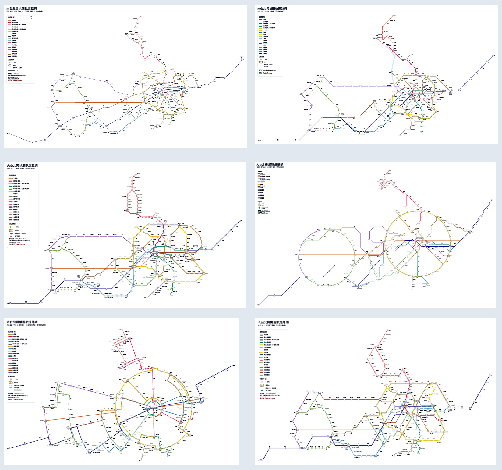

# TPE_Metro.xlsm 路網圖複驗

以 `262465e` 原始碼與 GitHub 專案內的原版工作簿產圖。六種路網版式各搭配四種站點符號，每張包含 270 個站點、15 條路線和 21 條路徑。資料含規劃路線、部分台鐵與高鐵站。工作簿有 270 個站點缺英文站名，校樣保留此資料範圍。

- [完整成果包 ZIP](https://github.com/k1vink1vin/metro-map-generator/archive/refs/tags/verification-262465e.zip) 收錄 24 張單頁 PDF、24 張完整版 SVG、重現說明、各項驗收及 Gemini 建議的對照實驗。
- [SVG 成果包 ZIP](downloads/tpe-metro-svg-262465e.zip) 適合快速逐圖比對，含完整版 SVG 和同批 PDF 的驗收資料。
- [印刷稽核 JSON](print-audit.json) 列出各圖的 SVG 與 PDF SHA-256、原大印刷尺寸及碰撞檢查。
- [對照實驗](experiments/README.md) 附可重現補丁，以及莫斯科雙環半徑與同心圓壓縮的量測結果。

地理版附 2 公里比例尺與站間直連說明。同心圓以台北車站為預設中心，另驗證忠孝復興與板橋。印刷校樣按原大尺寸檢閱，中文站名字級為 4.5 mm。

24 張圖均通過 Chromium 中的站名、站牌、路線與裁切檢查。各版式在各軸約 3.6 公里以上的站間方位比較中，最低正確率為 98.63%。

本成果包由 Node.js 24.22.1、Chromium 156 和 Noto Sans CJK TC 產製。GitHub Actions 使用 Node.js 22 及 Playwright Chromium 獨立重跑。

[PR #22](https://github.com/k1vink1vin/metro-map-generator/pull/22) · [重現指令與報告回應](https://github.com/k1vink1vin/metro-map-generator/blob/262465e82235b4e3b8bf4e7692225d7f11bbbc86/docs/PUBLICATION_QA.md) · [GitHub Actions 驗收](https://github.com/k1vink1vin/metro-map-generator/actions/runs/44760139936)

工作簿 SHA-256 為 `155f7bd67fe0740729eb08d034426a1ea9c16daaec1fbfd8b270feba8f829045`，產圖原始碼為 `262465e82235b4e3b8bf4e7692225d7f11bbbc86`。

## 六種版式預覽

採台北站牌符號。由左至右、由上至下為地理、台北、倫敦、莫斯科、同心圓、六角。

## 逐張校樣

| 路網版式 | 台北站牌 | 東京站牌 | 大阪站牌 | 莫斯科站牌 |
| --- | --- | --- | --- | --- |
| 地理 | [SVG](geographic--stations-taipei.svg) · [PDF](print/geographic--stations-taipei.pdf) | [SVG](geographic--stations-tokyo.svg) · [PDF](print/geographic--stations-tokyo.pdf) | [SVG](geographic--stations-osaka.svg) · [PDF](print/geographic--stations-osaka.pdf) | [SVG](geographic--stations-moscow.svg) · [PDF](print/geographic--stations-moscow.pdf) |
| 台北 | [SVG](taipei--stations-taipei.svg) · [PDF](print/taipei--stations-taipei.pdf) | [SVG](taipei--stations-tokyo.svg) · [PDF](print/taipei--stations-tokyo.pdf) | [SVG](taipei--stations-osaka.svg) · [PDF](print/taipei--stations-osaka.pdf) | [SVG](taipei--stations-moscow.svg) · [PDF](print/taipei--stations-moscow.pdf) |
| 倫敦 | [SVG](london--stations-taipei.svg) · [PDF](print/london--stations-taipei.pdf) | [SVG](london--stations-tokyo.svg) · [PDF](print/london--stations-tokyo.pdf) | [SVG](london--stations-osaka.svg) · [PDF](print/london--stations-osaka.pdf) | [SVG](london--stations-moscow.svg) · [PDF](print/london--stations-moscow.pdf) |
| 莫斯科 | [SVG](moscow--stations-taipei.svg) · [PDF](print/moscow--stations-taipei.pdf) | [SVG](moscow--stations-tokyo.svg) · [PDF](print/moscow--stations-tokyo.pdf) | [SVG](moscow--stations-osaka.svg) · [PDF](print/moscow--stations-osaka.pdf) | [SVG](moscow--stations-moscow.svg) · [PDF](print/moscow--stations-moscow.pdf) |
| 同心圓 | [SVG](concentric--stations-taipei.svg) · [PDF](print/concentric--stations-taipei.pdf) | [SVG](concentric--stations-tokyo.svg) · [PDF](print/concentric--stations-tokyo.pdf) | [SVG](concentric--stations-osaka.svg) · [PDF](print/concentric--stations-osaka.pdf) | [SVG](concentric--stations-moscow.svg) · [PDF](print/concentric--stations-moscow.pdf) |
| 六角 | [SVG](hex--stations-taipei.svg) · [PDF](print/hex--stations-taipei.pdf) | [SVG](hex--stations-tokyo.svg) · [PDF](print/hex--stations-tokyo.pdf) | [SVG](hex--stations-osaka.svg) · [PDF](print/hex--stations-osaka.pdf) | [SVG](hex--stations-moscow.svg) · [PDF](print/hex--stations-moscow.pdf) |
